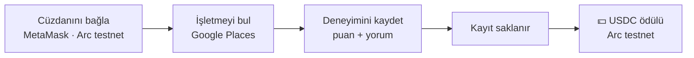

# 🧾 Arc Registry

🇹🇷 Türkçe · 🇬🇧 [English](#english)

**Hizmet sektörünün şeffaf kaydı, zincir üzerinde ödüllendirilir.**
Kullanıcılar gerçek işletmeleri (restoran, kafe, kuaför, servis, mağaza…) bulur, deneyimlerini kaydeder ve katkıları için **Arc testnet üzerinde USDC** ile ödüllendirilir. Amaç, hizmet kalitesine dair geri bildirimleri tek bir merkezin kontrolünde olmayan, şeffaf ve teşvikli bir kayda dönüştürmek.

🔗 **Canlı site:** https://yilmazalaz.github.io/arc-registry/

> ⚠️ Proje **Arc test ağında** çalışır. Ödüller test USDC'sidir, gerçek değeri yoktur.

---

## Nasıl çalışır?

1. **Cüzdanını bağla** — MetaMask ile Arc test ağına bağlan.
2. **İşletmeyi bul** — Google Places araması ile gerçek bir işletmeyi seç; adres ve konum bilgisi otomatik gelir.
3. **Deneyimini kaydet** — Hizmet hakkında puanını ve yorumunu yaz.
4. **Kayıt saklanır** — Geri bildirim, işletmeye ve cüzdan adresine bağlı olarak kaydedilir.
5. **Ödül al** — Katkın için Arc testnet üzerinde USDC ödülü cüzdanına gönderilir.

---

## Özellikler

- 📍 **Gerçek işletmeler** — Google Places entegrasyonu ile işletmeler adı, adresi ve konumuyla seçilir; uydurma kayıtların önüne geçilir.
- 📝 **Hizmet kayıtları** — Puan ve yorumlardan oluşan, herkesin görebildiği geri bildirim kaydı.
- 💵 **USDC ödülleri** — Katkılar Arc testnet üzerinde USDC ile ödüllendirilir.
- 🦊 **Cüzdan ile kimlik** — Hesap açmaya gerek yok; MetaMask cüzdan adresi kullanıcı kimliğidir.
- ☁️ **Firebase altyapısı** — Kayıtlar Firebase Firestore'da tutulur, arayüz anında güncellenir.

---

## Neden?

Bugün işletme yorumları büyük platformların kontrolündedir: yorumlar silinebilir, sıralamalar şeffaf değildir ve yorum yazan kullanıcı hiçbir şey kazanmaz. Arc Registry:

- **şeffaf** — kayıtlar herkese açık,
- **teşvikli** — katkı yapan kullanıcı ödül alır,
- **cüzdana bağlı** — her kayıt bir cüzdan adresiyle ilişkilidir

bir hizmet kaydı oluşturmayı hedefler.

---

## Nasıl denerim?

1. MetaMask'ı kur ve **Arc testnet** ağını ekle.
2. Siteyi aç: https://yilmazalaz.github.io/arc-registry/
3. Cüzdanını bağla, bir işletme ara ve deneyimini kaydet.
4. Ödülün cüzdanına geldiğini MetaMask'ta kontrol et.

---

## Teknoloji

- Tek sayfa HTML/JavaScript arayüz (GitHub Pages)
- Firebase Firestore (kayıtlar)
- Google Places API (işletme arama)
- MetaMask (cüzdan bağlantısı)
- Arc testnet · USDC (ödüller)

---

## 🇬🇧 English

**Arc Registry** is a transparent registry for the service sector, rewarded on-chain. Users find real businesses through Google Places, record their service experience (rating + comment), and get rewarded in **USDC on Arc testnet**. Each record is tied to a business and a wallet address, turning service feedback into an open, incentivized registry instead of one controlled by a single platform.

**How it works:** connect MetaMask (Arc testnet) → find a business with Google Places → record your experience → the record is stored → USDC reward is sent to your wallet.

**Stack:** single-page HTML/JS on GitHub Pages · Firebase Firestore · Google Places API · MetaMask · Arc testnet USDC.

Live: https://yilmazalaz.github.io/arc-registry/

> ⚠️ Runs on Arc testnet. Rewards are test USDC with no real value.
